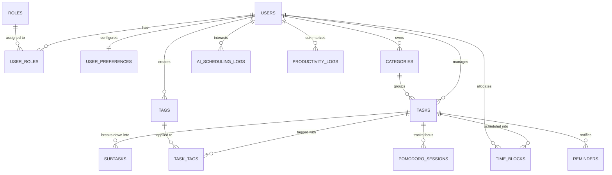

# TÀI LIỆU GIẢI THÍCH CHI TIẾT CƠ SỞ DỮ LIỆU (DATABASE SPECIFICATION)
## HỆ THỐNG QUẢN LÝ VÀ TỰ ĐỘNG LẬP LỊCH CÔNG VIỆC CÁ NHÂN (NHỊP - SMARTTASK AI)
**Hệ quản trị CSDL:** PostgreSQL 17  
**Database Name:** `quanlycongviec_db`  
**File kịch bản khởi tạo:** [`database/init_db_quanlycongviec.sql`](file:///d:/DACN_QUANLYCONGVIECCANHAN/database/init_db_quanlycongviec.sql)

---

## 1. TỔNG QUAN KIẾN TRÚC CƠ SỞ DỮ LIỆU

Hệ thống cơ sở dữ liệu được thiết kế chuẩn hóa (3NF), tối ưu hóa cho bài toán lập lịch tự động (Auto-scheduling), ma trận Eisenhower, hỗ trợ tích hợp Trí tuệ Nhân tạo Gemini AI và nhập liệu bằng giọng nói (Voice Input).

---

## 2. GIẢI THÍCH CHI TIẾT CÁC BẢNG VÀ TỪNG TRƯỜNG DỮ LIỆU

### 2.1. Bảng `users` (Quản lý Người dùng & Tài khoản)
Lưu trữ thông tin định danh người dùng trên cả nền tảng Web và Android.

| Tên trường (Column) | Kiểu dữ liệu | Ràng buộc | Giá trị mặc định | Giải thích ý nghĩa & Nghiệp vụ |
| :--- | :--- | :--- | :--- | :--- |
| `id` | `BIGSERIAL` | PRIMARY KEY | Tự tăng | Khóa chính định danh duy nhất người dùng. |
| `email` | `VARCHAR(120)` | NOT NULL, UNIQUE | | Địa chỉ email đăng nhập, dùng để xác thực và nhận thông báo. |
| `password_hash` | `VARCHAR(255)` | NOT NULL | | Mật khẩu đã được băm an toàn bằng thuật toán BCrypt. |
| `full_name` | `VARCHAR(100)` | NOT NULL | | Họ tên hiển thị của người dùng (ví dụ: *"Minh Anh"* trên giao diện). |
| `phone_number` | `VARCHAR(20)` | NULL | NULL | Số điện thoại liên hệ (phục vụ SMS nhắc nhở khẩn cấp nếu có). |
| `avatar_url` | `VARCHAR(500)` | NULL | NULL | Đường dẫn ảnh đại diện. Nếu rỗng, giao diện hiển thị avatar chữ cái viết tắt (như *"MA"*). |
| `auth_provider` | `VARCHAR(20)` | NOT NULL | `'LOCAL'` | Phương thức xác thực: `'LOCAL'` (Email/Password) hoặc `'GOOGLE'` (OAuth2). |
| `is_active` | `BOOLEAN` | NOT NULL | `TRUE` | Trạng thái kích hoạt tài khoản. `FALSE` khi tài khoản bị khóa. |
| `is_email_verified`| `BOOLEAN` | NOT NULL | `FALSE` | Trạng thái xác thực email sau khi đăng ký. |
| `created_at` | `TIMESTAMPTZ` | NOT NULL | `CURRENT_TIMESTAMP` | Thời điểm đăng ký tài khoản. |
| `updated_at` | `TIMESTAMPTZ` | NOT NULL | `CURRENT_TIMESTAMP` | Thời điểm cập nhật thông tin cá nhân lần gần nhất. |

---

### 2.2. Bảng `roles` & `user_roles` (Phân quyền bảo mật RBAC)
Phục vụ cơ chế Spring Security phân quyền người dùng và quản trị viên.

#### Bảng `roles`:
| Tên trường | Kiểu dữ liệu | Ràng buộc | Ý nghĩa |
| :--- | :--- | :--- | :--- |
| `id` | `SERIAL` | PRIMARY KEY | Khóa chính vai trò. |
| `name` | `VARCHAR(50)` | NOT NULL, UNIQUE | Mã vai trò: `'ROLE_USER'` (Người dùng cá nhân), `'ROLE_ADMIN'` (Quản trị viên hệ thống). |
| `description` | `VARCHAR(255)` | NULL | Mô tả chi tiết quyền hạn của vai trò. |

#### Bảng `user_roles`:
| Tên trường | Kiểu dữ liệu | Ràng buộc | Ý nghĩa |
| :--- | :--- | :--- | :--- |
| `user_id` | `BIGINT` | NOT NULL, FK(`users.id`) | Khóa ngoại tham chiếu đến người dùng. Tự xóa khi user bị xóa (`ON DELETE CASCADE`). |
| `role_id` | `INT` | NOT NULL, FK(`roles.id`) | Khóa ngoại tham chiếu đến vai trò. |
*(Khóa chính kết hợp: `PRIMARY KEY (user_id, role_id)`)*

---

### 2.3. Bảng `user_preferences` (Cấu hình Thói quen cá nhân & Thuật toán AI)
Lưu trữ các tham số quan trọng để Động cơ Lập lịch Tự động (Auto-Scheduling Engine) biết khung giờ nào người dùng rảnh, giờ làm việc, và khoảng thời gian đệm.

| Tên trường | Kiểu dữ liệu | Ràng buộc | Giá trị mặc định | Giải thích ý nghĩa & Nghiệp vụ |
| :--- | :--- | :--- | :--- | :--- |
| `id` | `BIGSERIAL` | PRIMARY KEY | Tự tăng | Khóa chính cấu hình. |
| `user_id` | `BIGINT` | NOT NULL, UNIQUE, FK | | Khóa ngoại 1-1 với `users.id`. Mỗi người dùng có một bản ghi cấu hình thói quen. |
| `work_start_time` | `TIME` | NOT NULL | `'08:00:00'` | Giờ bắt đầu một ngày làm việc (mặc định 08:00 sáng). |
| `work_end_time` | `TIME` | NOT NULL | `'18:00:00'` | Giờ kết thúc ngày làm việc (mặc định 18:00 chiều). |
| `working_days` | `VARCHAR(50)` | NOT NULL | `'MON,TUE,WED,THU,FRI'` | Danh sách các ngày làm việc trong tuần. Phục vụ AI tránh xếp lịch vào ngày nghỉ. |
| `buffer_time_minutes` | `INT` | NOT NULL | `15` | Thời gian đệm (Buffer time) tối thiểu giữa 2 công việc liên tiếp (15 phút nghỉ ngơi). |
| `peak_productivity_time` | `VARCHAR(20)`| NOT NULL | `'MORNING'` | Khung giờ tập trung cao độ nhất: `'MORNING'`, `'AFTERNOON'`, hoặc `'EVENING'`. AI sẽ ưu tiên đưa việc quan trọng vào khung giờ này. |
| `default_pomodoro_minutes` | `INT` | NOT NULL | `25` | Thời lượng mặc định một phiên tập trung Pomodoro (25 phút). |
| `default_short_break_minutes`| `INT` | NOT NULL | `5` | Thời gian giải lao ngắn giữa các phiên (5 phút). |
| `default_long_break_minutes` | `INT` | NOT NULL | `15` | Thời gian giải lao dài sau 4 chu kỳ Pomodoro (15 phút). |
| `auto_reschedule_enabled` | `BOOLEAN` | NOT NULL | `TRUE` | Cho phép AI tự động tìm khung giờ trống mới và dời lịch khi một công việc bị trễ hoặc xung đột. |
| `timezone` | `VARCHAR(50)` | NOT NULL | `'Asia/Ho_Chi_Minh'` | Múi giờ người dùng (GMT+7). Hiển thị trên đầu cột thời gian lịch biểu. |
| `theme` | `VARCHAR(20)` | NOT NULL | `'LIGHT'` | Giao diện: `'LIGHT'`, `'DARK'`, hoặc `'SYSTEM'`. |
| `created_at` / `updated_at` | `TIMESTAMPTZ` | NOT NULL | `CURRENT_TIMESTAMP` | Thời điểm khởi tạo và cập nhật cấu hình. |

---

### 2.4. Bảng `categories` (Danh mục & Nhóm công việc)
Tương ứng với mục **"Nhóm của tôi"** trên thanh Sidebar bên trái của giao diện: *Học tập, Công việc, Sức khỏe, Giải trí*.

| Tên trường | Kiểu dữ liệu | Ràng buộc | Giá trị mặc định | Giải thích ý nghĩa & Nghiệp vụ |
| :--- | :--- | :--- | :--- | :--- |
| `id` | `BIGSERIAL` | PRIMARY KEY | Tự tăng | Khóa chính danh mục. |
| `user_id` | `BIGINT` | NOT NULL, FK | | Khóa ngoại người sở hữu danh mục. |
| `name` | `VARCHAR(100)`| NOT NULL | | Tên nhóm công việc: *Học tập, Công việc, Sức khỏe, Giải trí*. |
| `color_code` | `VARCHAR(20)` | NOT NULL | `'#4F46E5'` | Mã màu HEX đại diện (ví dụ: `#3B82F6` xanh dương, `#8B5CF6` tím, `#10B981` xanh lá, `#F59E0B` cam). |
| `icon_name` | `VARCHAR(50)` | NULL | `'Folder'` | Tên biểu tượng Lucide (như `BookOpen`, `Briefcase`, `Heart`, `Gamepad2`). |
| `is_default` | `BOOLEAN` | NOT NULL | `FALSE` | Cờ đánh dấu danh mục mặc định của hệ thống khi vừa tạo tài khoản. |
| `created_at` / `updated_at` | `TIMESTAMPTZ` | NOT NULL | `CURRENT_TIMESTAMP` | Dấu vết thời gian tạo và cập nhật. |

---

### 2.5. Bảng `tags` & `task_tags` (Nhãn phân loại)
Cho phép gắn nhiều thẻ linh hoạt vào công việc (ví dụ: `#DoAn`, `#BaoCao`, `#Meeting`, `#DeepWork`).

#### Bảng `tags`:
| Tên trường | Kiểu dữ liệu | Ràng buộc | Ý nghĩa |
| :--- | :--- | :--- | :--- |
| `id` | `BIGSERIAL` | PRIMARY KEY | Khóa chính thẻ tag. |
| `user_id` | `BIGINT` | NOT NULL, FK | Người tạo thẻ. |
| `name` | `VARCHAR(50)` | NOT NULL | Tên nhãn ngắn gọn. |
| `color_code` | `VARCHAR(20)` | NOT NULL | Mã màu thẻ hiển thị. |

#### Bảng `task_tags`:
| Tên trường | Kiểu dữ liệu | Ràng buộc | Ý nghĩa |
| :--- | :--- | :--- | :--- |
| `task_id` | `BIGINT` | NOT NULL, FK(`tasks.id`) | Khóa ngoại tham chiếu công việc. |
| `tag_id` | `BIGINT` | NOT NULL, FK(`tags.id`) | Khóa ngoại tham chiếu nhãn tag. |

---

### 2.6. Bảng `tasks` (Công việc / Nhiệm vụ cốt lõi)
Bảng trung tâm quản lý mọi đầu việc, liên kết ma trận Eisenhower, mức độ ưu tiên, hạn chót và thông tin AI nhận diện từ giọng nói.

| Tên trường | Kiểu dữ liệu | Ràng buộc | Giá trị mặc định | Giải thích ý nghĩa & Nghiệp vụ |
| :--- | :--- | :--- | :--- | :--- |
| `id` | `BIGSERIAL` | PRIMARY KEY | Tự tăng | Khóa chính công việc. |
| `user_id` | `BIGINT` | NOT NULL, FK | | Khóa ngoại người sở hữu công việc. |
| `category_id` | `BIGINT` | NULL, FK | NULL | Nhóm công việc trực thuộc (`Học tập`, `Công việc`,...). |
| `title` | `VARCHAR(255)`| NOT NULL | | Tên công việc (ví dụ: *"Làm báo cáo đồ án"*, *"Thiết kế giao diện"*). |
| `description` | `TEXT` | NULL | NULL | Nội dung chi tiết, ghi chú đính kèm công việc. |
| `priority` | `VARCHAR(20)` | NOT NULL | `'MEDIUM'` | Mức độ ưu tiên: `'LOW'`, `'MEDIUM'`, `'HIGH'`, `'URGENT'`. |
| `eisenhower_quadrant`| `VARCHAR(20)` | NOT NULL | `'SCHEDULE'` | Phân loại ma trận Eisenhower: `'DO_FIRST'` (Khẩn cấp & Quan trọng), `'SCHEDULE'` (Quan trọng, không khẩn cấp), `'DELEGATE'` (Khẩn cấp, không quan trọng), `'DONT_DO'` (Không quan trọng, không khẩn cấp). |
| `status` | `VARCHAR(20)` | NOT NULL | `'TODO'` | Trạng thái thực hiện: `'TODO'` (Cần làm), `'IN_PROGRESS'` (Đang làm), `'COMPLETED'` (Đã hoàn thành), `'CANCELLED'` (Đã hủy), `'OVERDUE'` (Quá hạn). |
| `estimated_duration_minutes` | `INT` | NOT NULL | `60` | Thời lượng ước tính cần hoàn thành (phút). AI dùng thông số này để phân bổ độ dài block thời gian. |
| `actual_duration_minutes` | `INT` | NOT NULL | `0` | Thời gian thực tế đã bỏ ra (được cộng dồn từ các phiên Pomodoro). |
| `due_date` | `TIMESTAMPTZ` | NULL | NULL | Hạn chót (Deadline) hoàn thành công việc. |
| `is_fixed_time` | `BOOLEAN` | NOT NULL | `FALSE` | Cờ cố định giờ: Nếu `TRUE` (như lịch họp, học trên lớp), AI **không được phép tự dời giờ**; nếu `FALSE`, AI có thể tự động xếp giờ trống linh hoạt. |
| `is_recurring` | `BOOLEAN` | NOT NULL | `FALSE` | Đánh dấu công việc lặp lại định kỳ (ví dụ: Tập gym mỗi ngày, Lên kế hoạch tuần vào sáng Thứ Hai). Hiển thị biểu tượng lặp lại `↻` trên calendar. |
| `recurrence_rule` | `VARCHAR(100)`| NULL | NULL | Chu kỳ lặp lại: `'DAILY'`, `'WEEKLY'`, `'MONTHLY'`, hoặc biểu thức RRULE chuẩn iCalendar. |
| `created_via` | `VARCHAR(20)` | NOT NULL | `'MANUAL'` | Phương thức tạo công việc: `'MANUAL'` (Tự nhập tay), `'AI_CHAT'` (Chatbot gợi ý), hoặc `'AI_VOICE'` (Nhận diện từ giọng nói). |
| `completed_at` | `TIMESTAMPTZ` | NULL | NULL | Thời điểm hoàn thành công việc (phục vụ thống kê năng suất). |
| `created_at` / `updated_at` | `TIMESTAMPTZ` | NOT NULL | `CURRENT_TIMESTAMP` | Thời điểm tạo và chỉnh sửa công việc. |

---

### 2.7. Bảng `subtasks` (Công việc con / Checklists)
Lưu danh sách các bước con cần thực hiện. Khi người dùng nhập câu lệnh phức tạp, AI Gemini sẽ tự động phân rã (Breakdown) công việc lớn thành các subtasks này.

| Tên trường | Kiểu dữ liệu | Ràng buộc | Giá trị mặc định | Giải thích ý nghĩa & Nghiệp vụ |
| :--- | :--- | :--- | :--- | :--- |
| `id` | `BIGSERIAL` | PRIMARY KEY | Tự tăng | Khóa chính việc con. |
| `task_id` | `BIGINT` | NOT NULL, FK | | Khóa ngoại tham chiếu đến công việc cha (`ON DELETE CASCADE`). |
| `title` | `VARCHAR(255)`| NOT NULL | | Tên bước công việc con cần làm. |
| `is_completed` | `BOOLEAN` | NOT NULL | `FALSE` | Cờ đánh dấu đã hoàn thành bước con này hay chưa. |
| `sort_order` | `INT` | NOT NULL | `0` | Thứ tự hiển thị các bước con. |
| `created_at` | `TIMESTAMPTZ` | NOT NULL | `CURRENT_TIMESTAMP` | Thời điểm tạo. |

---

### 2.8. Bảng `time_blocks` (Khối thời gian trên Lịch biểu - Time-blocking)
**Đây là bảng trực tiếp ánh xạ ra Lưới lịch tuần (Weekly Calendar Grid) trên màn hình giao diện!**  
Mỗi khối ô màu trên lịch tương ứng với một bản ghi trong bảng này.

| Tên trường | Kiểu dữ liệu | Ràng buộc | Giá trị mặc định | Giải thích ý nghĩa & Nghiệp vụ |
| :--- | :--- | :--- | :--- | :--- |
| `id` | `BIGSERIAL` | PRIMARY KEY | Tự tăng | Khóa chính khối thời gian. |
| `user_id` | `BIGINT` | NOT NULL, FK | | Khóa ngoại người sở hữu lịch biểu. |
| `task_id` | `BIGINT` | NULL, FK | NULL | Tham chiếu đến công việc được gán. Có thể `NULL` nếu là sự kiện sinh hoạt riêng không gắn task. |
| `title` | `VARCHAR(255)`| NOT NULL | | Tiêu đề khối thời gian hiển thị trên lịch (*"Thiết kế giao diện"*, *"Yoga buổi sáng"*...). |
| `start_time` | `TIMESTAMPTZ` | NOT NULL | | Thời gian bắt đầu khối lịch (ví dụ: `2026-10-13 09:00:00+07`). |
| `end_time` | `TIMESTAMPTZ` | NOT NULL | | Thời gian kết thúc khối lịch (ví dụ: `2026-10-13 11:00:00+07`). |
| `is_auto_scheduled`| `BOOLEAN` | NOT NULL | `FALSE` | Cờ đánh dấu khối này do **AI tự động xếp** vào khoảng trống hay do người dùng tự đặt tay. |
| `is_locked` | `BOOLEAN` | NOT NULL | `FALSE` | Khóa vị trí: Nếu `TRUE`, AI không bao giờ được phép dời khối này khi tối ưu lịch. |
| `color_override` | `VARCHAR(20)` | NULL | NULL | Ghi đè màu sắc riêng cho khối lịch (nếu khác màu danh mục). |
| `notes` | `TEXT` | NULL | NULL | Ghi chú thêm cho phiên làm việc này. |
| `created_at` / `updated_at` | `TIMESTAMPTZ` | NOT NULL | `CURRENT_TIMESTAMP` | Thời điểm tạo và cập nhật khối lịch (khi người dùng kéo thả ô lịch). |

---

### 2.9. Bảng `pomodoro_sessions` (Phiên tập trung Pomodoro & Theo dõi Năng suất)
Ghi nhận lịch sử người dùng bật chế độ tập trung làm việc, đo lường số giờ tập trung thực tế hiển thị trên thẻ **"Thời gian tập trung: 13 giờ"** của Stats Bar.

| Tên trường | Kiểu dữ liệu | Ràng buộc | Giá trị mặc định | Giải thích ý nghĩa & Nghiệp vụ |
| :--- | :--- | :--- | :--- | :--- |
| `id` | `BIGSERIAL` | PRIMARY KEY | Tự tăng | Khóa chính phiên tập trung. |
| `task_id` | `BIGINT` | NOT NULL, FK | | Công việc đang được thực hiện trong phiên này. |
| `user_id` | `BIGINT` | NOT NULL, FK | | Người dùng thực hiện. |
| `session_type` | `VARCHAR(20)` | NOT NULL | `'WORK'` | Loại phiên: `'WORK'` (Làm việc tập trung), `'SHORT_BREAK'` (Nghỉ ngắn), `'LONG_BREAK'` (Nghỉ dài). |
| `duration_minutes` | `INT` | NOT NULL | `25` | Thời lượng dự kiến của phiên (phút). |
| `actual_duration_seconds` | `INT` | NOT NULL | `0` | Số giây người dùng thực sự tập trung không tắt tab / không dừng. |
| `is_completed` | `BOOLEAN` | NOT NULL | `TRUE` | `TRUE` nếu hoàn thành trọn vẹn cả phiên mà không bị hủy giữa chừng. |
| `started_at` | `TIMESTAMPTZ` | NOT NULL | `CURRENT_TIMESTAMP` | Thời điểm bắt đầu phiên. |
| `ended_at` | `TIMESTAMPTZ` | NULL | NULL | Thời điểm kết thúc phiên. |

---

### 2.10. Bảng `reminders` (Nhắc nhở & Thông báo)
Quản lý các thời điểm nhắc hẹn trước giờ bắt đầu công việc.

| Tên trường | Kiểu dữ liệu | Ràng buộc | Giá trị mặc định | Giải thích ý nghĩa & Nghiệp vụ |
| :--- | :--- | :--- | :--- | :--- |
| `id` | `BIGSERIAL` | PRIMARY KEY | Tự tăng | Khóa chính lời nhắc. |
| `task_id` | `BIGINT` | NOT NULL, FK | | Công việc cần nhắc nhở. |
| `user_id` | `BIGINT` | NOT NULL, FK | | Người nhận thông báo. |
| `remind_at` | `TIMESTAMPTZ` | NOT NULL | | Thời điểm hệ thống sẽ bắn thông báo. |
| `reminder_type` | `VARCHAR(20)` | NOT NULL | `'PUSH_NOTIFICATION'`| Kênh gửi: `'PUSH_NOTIFICATION'`, `'EMAIL'`, hoặc `'IN_APP'`. |
| `is_sent` | `BOOLEAN` | NOT NULL | `FALSE` | Trạng thái đã gửi thông báo hay chưa. |
| `created_at` | `TIMESTAMPTZ` | NOT NULL | `CURRENT_TIMESTAMP` | Thời điểm tạo nhắc nhở. |

---

### 2.11. Bảng `ai_scheduling_logs` (Nhật ký Phân tích & Lập lịch AI - Gemini API & Voice)
**Lưu vết toàn bộ quá trình giao tiếp giữa Người dùng và Trợ lý AI Nhịp (Panel bên phải giao diện)**, bao gồm giọng nói đầu vào, kết quả AI trích xuất thực thể, phát hiện xung đột và đề xuất dời lịch.

| Tên trường | Kiểu dữ liệu | Ràng buộc | Giá trị mặc định | Giải thích ý nghĩa & Nghiệp vụ |
| :--- | :--- | :--- | :--- | :--- |
| `id` | `BIGSERIAL` | PRIMARY KEY | Tự tăng | Khóa chính nhật ký AI. |
| `user_id` | `BIGINT` | NOT NULL, FK | | Người dùng tương tác với AI. |
| `input_prompt` | `TEXT` | NOT NULL | | Lời nói hoặc văn bản người dùng nhập (ví dụ: *"Nhắc tôi làm báo cáo đồ án vào chiều mai lúc 3h"*). |
| `input_type` | `VARCHAR(20)` | NOT NULL | `'TEXT'` | Nguồn dữ liệu: `'TEXT'` (Gõ phím) hoặc `'VOICE'` (Thu qua nút Mic). |
| `ai_action_type` | `VARCHAR(50)` | NOT NULL | `'SCHEDULE_TASK'` | Thao tác dự định: `'SCHEDULE_TASK'`, `'BREAKDOWN_TASK'`, `'RESCHEDULE_CONFLICT'`, `'PRODUCTIVITY_INSIGHT'`. |
| `raw_gemini_response` | `JSONB` | NULL | NULL | Chuỗi phản hồi JSON nguyên bản trả về từ Google Gemini API. |
| `parsed_task_title` | `VARCHAR(255)`| NULL | NULL | Tên việc AI bóc tách được (*"Làm báo cáo đồ án"*). |
| `suggested_start_time` | `TIMESTAMPTZ` | NULL | NULL | Giờ bắt đầu AI đề xuất (*"Thứ Tư, 14/10 · 15:00"*). |
| `suggested_end_time` | `TIMESTAMPTZ` | NULL | NULL | Giờ kết thúc AI đề xuất (*"16:00"*). |
| `conflict_detected` | `BOOLEAN` | NOT NULL | `FALSE` | Cờ báo phát hiện xung đột trùng giờ (`TRUE` nếu trùng lịch). |
| `conflict_details` | `TEXT` | NULL | NULL | Chi tiết xung đột hiển thị ở hộp cảnh báo màu vàng (*"Trùng với Họp nhóm đồ án, 15:00–16:00. Mình đã tìm 3 giờ thay thế."*). |
| `user_accepted` | `BOOLEAN` | NULL | NULL | Phản hồi của người dùng: `TRUE` khi bấm *"Xác nhận & chọn giờ khác"*, `FALSE` nếu từ chối, `NULL` nếu đang chờ quyết định. |
| `created_at` | `TIMESTAMPTZ` | NOT NULL | `CURRENT_TIMESTAMP` | Thời điểm ghi nhận tương tác. |

---

### 2.12. Bảng `productivity_logs` (Nhật ký & Báo cáo Năng suất tổng hợp)
Cung cấp số liệu cho thanh thống kê dưới đáy màn hình (**StatsBar**) và biểu đồ báo cáo hiệu suất cá nhân.

| Tên trường | Kiểu dữ liệu | Ràng buộc | Giá trị mặc định | Giải thích ý nghĩa & Nghiệp vụ |
| :--- | :--- | :--- | :--- | :--- |
| `id` | `BIGSERIAL` | PRIMARY KEY | Tự tăng | Khóa chính bản ghi năng suất. |
| `user_id` | `BIGINT` | NOT NULL, FK | | Người dùng được tính toán năng suất. |
| `log_date` | `DATE` | NOT NULL | | Ngày ghi nhận số liệu. |
| `tasks_completed_count` | `INT` | NOT NULL | `0` | Số lượng công việc hoàn thành trong ngày/tuần (ví dụ: *3 đã hoàn thành*). |
| `tasks_created_count` | `INT` | NOT NULL | `0` | Tổng số công việc trong tuần (ví dụ: *14 công việc tuần này*). |
| `focus_time_minutes` | `INT` | NOT NULL | `0` | Tổng số phút tập trung tích lũy (quy đổi ra *13 giờ* trên Stats Bar). |
| `available_free_slots` | `INT` | NOT NULL | `0` | Số khoảng trống còn lại trên lịch có thể xếp việc (*8 khoảng trống*). |
| `ai_score` | `DECIMAL(5,2)`| NULL | NULL | Điểm năng suất được AI chấm điểm dựa trên tỉ lệ hoàn thành và tính đúng hạn (thang 100). |
| `ai_feedback_summary` | `TEXT` | NULL | NULL | Nhận xét và khuyến nghị ngắn của AI gửi cho người dùng mỗi cuối ngày. |
| `created_at` | `TIMESTAMPTZ` | NOT NULL | `CURRENT_TIMESTAMP` | Thời điểm tổng hợp dữ liệu. |

---

## 3. BẢNG QUY ĐỔI ÁNH XẠ GIỮA GIAO DIỆN "NHỊP" VÀ TRƯỜNG DỮ LIỆU CSDL

| Thành phần trên Giao diện Mockup | Hiển thị cụ thể | Nguồn bảng dữ liệu | Trường dữ liệu tương ứng |
| :--- | :--- | :--- | :--- |
| **User Profile (Sidebar góc dưới trái)** | *"Minh Anh"*, *"Tài khoản cá nhân"*, Avatar *"MA"* | `users` | `full_name`, `avatar_url` |
| **Nhóm của tôi (Sidebar)** | *Học tập (xanh)*, *Công việc (tím)*, *Sức khỏe (xanh lá)*, *Giải trí (vàng)* | `categories` | `name`, `color_code`, `icon_name` |
| **Header Lịch tuần** | *"Thứ Ba, 13"*, múi giờ *"GMT+7"* | `user_preferences` | `timezone`, `work_start_time`, `work_end_time` |
| **Các ô sự kiện trên Lịch biểu** | *"Thiết kế giao diện 09:00–11:00 (Đang làm)"* | `time_blocks` & `tasks` | `time_blocks.title`, `time_blocks.start_time`, `time_blocks.end_time`, `tasks.status`, `tasks.priority` |
| **Biểu tượng lặp lại ↻ trên ô lịch** | *"Lên kế hoạch tuần"*, *"Học tiếng Anh"*,... | `tasks` | `is_recurring`, `recurrence_rule` |
| **Thẻ Thống kê 1 (StatsBar)** | **14** (3 đã hoàn thành) | `productivity_logs` | `tasks_created_count`, `tasks_completed_count` |
| **Thẻ Thống kê 2 (StatsBar)** | **13 giờ** (Học tập & Công việc) | `pomodoro_sessions` & `productivity_logs` | `focus_time_minutes` quy đổi ra giờ |
| **Thẻ Thống kê 3 (StatsBar)** | **8** (Sẵn sàng để AI sắp xếp) | `productivity_logs` | `available_free_slots` tính từ thuật toán tìm slot rảnh |
| **Hộp thoại Trợ lý AI (Panel phải)** | *"Nhắc tôi làm báo cáo đồ án vào chiều mai lúc 3h"* | `ai_scheduling_logs` | `input_prompt`, `input_type` = `'VOICE'` / `'TEXT'` |
| **Cảnh báo xung đột AI** | ⚠ *"Khung giờ này đang bận. Trùng với Họp nhóm đồ án..."* | `ai_scheduling_logs` | `conflict_detected` = `TRUE`, `conflict_details` |
| **Nút bấm Mic (Voice Input)** | Nút Microphone bấm để nhận diện tiếng Việt | `ai_scheduling_logs` | Kích hoạt Web Speech API (`SpeechRecognition`), ghi âm và truyền kết quả text vào `input_prompt` |

---

## 4. CHIẾN LƯỢC TỐI ƯU HÓA CHỈ MỤC (INDEXING STRATEGY)

Để đảm bảo hiệu năng truy vấn tức thì dưới 50ms khi tải lịch tuần và tìm kiếm slot thời gian trống:

1. **`idx_time_blocks_user_time (user_id, start_time, end_time)`**:
   Tối ưu hóa phép quét khoảng thời gian hàng tuần `WHERE user_id = ? AND start_time >= ? AND end_time <= ?`. Giúp hiển thị 7 ngày lịch biểu ngay lập tức.
2. **`idx_tasks_user_status (user_id, status)`**:
   Tối ưu hóa việc lọc danh sách các công việc còn tồn đọng (`TODO`, `IN_PROGRESS`) để đưa vào hàng đợi lập lịch.
3. **`idx_tasks_user_priority (user_id, priority)`**:
   Tối ưu hóa sắp xếp công việc theo độ ưu tiên khi thuật toán giải bài toán xếp lịch (Greedy/Interval Scheduling).
4. **`idx_ai_logs_user (user_id, created_at DESC)`**:
   Tải nhanh lịch sử trao đổi của người dùng với trợ lý AI gần nhất.

---
*Tài liệu được biên soạn phục vụ đồ án chuyên ngành và đối soát chuẩn xác với kịch bản [`database/init_db_quanlycongviec.sql`](file:///d:/DACN_QUANLYCONGVIECCANHAN/database/init_db_quanlycongviec.sql).*
